<!-- ═══════════════════════ HEADER ═══════════════════════ -->

  

  

  
  
  
  

---

## 👨‍💻 Sobre mí

Soy estudiante de **Ingeniería de Software** en la **Universidad Técnica de Ambato** (7.º semestre) y me enfoco en el desarrollo **full-stack**: interfaces modernas y accesibles en el frontend, y APIs bien estructuradas en el backend. Me gusta llevar un proyecto desde el diseño hasta el despliegue.

- 🔭 Construyendo proyectos con **React + Vite**, **Next.js** y **Spring Boot**
- 🌱 Aprendiendo **Next.js con TypeScript**, **testing** (Vitest / Testing Library) y **microservicios con gRPC + Docker**
- 🤝 Busco **prácticas pre-profesionales** y proyectos reales donde aportar
- 📍 Píllaro, Ecuador

---

## 🛠️ Tech Stack

<table align="center">
  <tr>
    <td align="right"><b>Lenguajes</b></td>
    <td></td>
  </tr>
  <tr>
    <td align="right"><b>Frontend</b></td>
    <td></td>
  </tr>
  <tr>
    <td align="right"><b>Backend</b></td>
    <td></td>
  </tr>
  <tr>
    <td align="right"><b>Bases de datos</b></td>
    <td></td>
  </tr>
  <tr>
    <td align="right"><b>DevOps & Cloud</b></td>
    <td></td>
  </tr>
  <tr>
    <td align="right"><b>Herramientas</b></td>
    <td></td>
  </tr>
</table>

---

## 🚀 Proyectos destacados

<table>
  <tr>
    <td width="50%" valign="top">
      <h3 align="center">🛡️ Walk Seguros</h3>
      

        
      

      
Plataforma web para la gestión de seguros de vida y materiales, con tres roles (Administrador, Agente y Usuario) y una integración limpia entre cliente y servidor.

      

        
        
        
      

      <!-- Agrega aquí el enlace al repo: 
<a href="URL_DEL_REPO">Ver repositorio →</a>
 -->
    </td>
    <td width="50%" valign="top">
      <h3 align="center">📊 Contabilidad</h3>
      

        
      

      
Sistema de registro contable de ventas y compras, con gestión de distribuidores y un kardex para el control detallado del inventario.

      

        
      

      
<a href="https://github.com/LUISALEXANDERQUISHPE/Proyecto_Contabilidadd">Ver repositorio →</a>

    </td>
  </tr>
  <tr>
    <td width="50%" valign="top">
      <h3 align="center">📚 LitHub</h3>
      

        
      

      
Aplicación de escritorio que simula una librería en línea: los lectores se registran y exploran el catálogo, y los autores pueden publicar sus propias obras.

      <!-- Agrega aquí el enlace al repo: 
<a href="URL_DEL_REPO">Ver repositorio →</a>
 -->
    </td>
    <td width="50%" valign="top">
      <h3 align="center">🌴 JungleLetras</h3>
      

        
      

      
Juego educativo de sopa de letras que ayuda a aprender a identificar filas y columnas de forma divertida.

      <!-- Agrega aquí el enlace al repo: 
<a href="URL_DEL_REPO">Ver repositorio →</a>
 -->
    </td>
  </tr>
</table>

---

## 📈 Estadísticas

<!-- stats.svg y top-langs.svg se generan solos con .github/workflows/readme-stats.yml -->

  
  

  

<!-- La serpiente se genera con .github/workflows/snake.yml en la rama "output" -->

  <picture>
    <source media="(prefers-color-scheme: dark)" srcset="https://raw.githubusercontent.com/LUISALEXANDERQUISHPE/LUISALEXANDERQUISHPE/output/github-snake-dark.svg" />
    <source media="(prefers-color-scheme: light)" srcset="https://raw.githubusercontent.com/LUISALEXANDERQUISHPE/LUISALEXANDERQUISHPE/output/github-snake.svg" />
    
  </picture>

---

## 📫 Hablemos

¿Tienes un proyecto, una vacante de prácticas o quieres ver una demo? Escríbeme a **[lquishpe1021@gmail.com](mailto:lquishpe1021@gmail.com)** o por **[LinkedIn](https://www.linkedin.com/in/luis-quishpe-lopez-135492230)**.

  

