<!-- ═══════════════════════ HEADER ═══════════════════════ -->
<!-- La información sale del portafolio (lib/site.ts, i18n-provider.tsx, sections/*). Si cambias algo allá, cámbialo aquí. -->

  

  

  
  
  
  
  
  

---

## 👨‍💻 Sobre mí

Soy estudiante de **Ingeniería de Software** en la **Universidad Técnica de Ambato** (**8.º semestre**). Construyo **APIs con Java (Spring Boot) y .NET** y **frontends con React / Next.js**. Manejo **PostgreSQL / MySQL** y **Docker**, y trabajo con **Git / GitHub** y metodologías **Scrum / Kanban**.

Me considero sociable, con capacidad para trabajar en equipo y aportar soluciones efectivas.

- 🎯 Busco **prácticas** o un puesto de **desarrollador junior** para aportar en backend o full stack
- 🏆 **2.º lugar** en el Concurso de Programación Avanzada 2025 (FISEI, Universidad Técnica de Ambato)
- 📱 Desarrollo web y móvil: React Native, Flutter y .NET MAUI
- 📍 Píllaro, Tungurahua, Ecuador

---

## 🛠️ Tech Stack

<table align="center">
  <tr>
    <td align="right"><b>Frontend</b></td>
    <td></td>
  </tr>
  <tr>
    <td align="right"><b>Backend</b></td>
    <td></td>
  </tr>
  <tr>
    <td align="right"><b>Bases de datos</b></td>
    <td></td>
  </tr>
  <tr>
    <td align="right"><b>Móvil</b></td>
    <td></td>
  </tr>
  <tr>
    <td align="right"><b>Cloud y herramientas</b></td>
    <td></td>
  </tr>
  <tr>
    <td align="right"><b>Editores</b></td>
    <td></td>
  </tr>
</table>

  
  
  
  
  
  
  
  
  
  

---

## 🚀 Proyectos destacados

<table>
  <tr>
    <td width="50%" valign="top">
      <h3 align="center">💊 Plataforma de Farmacia en Línea</h3>
      

        
      

      
Comercio de medicinas online con panel web para administradores y app móvil para clientes.

      

        
        
        
        
        
      

      

        <a href="https://farmayabackend.onrender.com/farmaya/docs">Documentación de la API →</a>
      

    </td>
    <td width="50%" valign="top">
      <h3 align="center">🐾 Sistema de Gestión Veterinaria</h3>
      

        
      

      
Gestión completa de una clínica veterinaria, con panel web para administradores y app móvil para dueños de mascotas.

      

        
        
        
        
        
      

      

        <a href="https://github.com/W1llAn/Backend_Huellitasoft">Backend</a>
      

    </td>
  </tr>
  <tr>
    <td width="50%" valign="top">
      <h3 align="center">🛡️ Walk Seguros</h3>
      

        
      

      
Gestión de seguros con 3 roles (Administrador, Agente y Cliente): pólizas, registro de clientes y documentos automatizados, con buenas prácticas de arquitectura entre cliente y servidor.

      

        
        
        
        
      

      

        <a href="https://github.com/IsmaelSailema20/GestionSegurosBackend">Backend</a> ·
        <a href="https://github.com/IsmaelSailema20/GestionSegurosFrontend">Frontend</a> ·
        <a href="https://gestion-seguros-frontend.vercel.app/">Demo →</a>
      

    </td>
    <td width="50%" valign="top">
      <h3 align="center">🏥 Gestión de Hospitales con Sucursales</h3>
      

        
      

      
Administra varias sucursales, personal, citas médicas e historiales de pacientes a nivel nacional.

      

        
        
        
        
      

      

        <a href="https://github.com/W1llAn/GestionHospitalesBackend">Backend</a> ·
        <a href="https://github.com/W1llAn/GestionHospitalesFrontend">Frontend</a>
      

    </td>
  </tr>
</table>

  

---

## 🎓 Formación y logros

| Año | | |
| --- | --- | --- |
| 2021 – hoy | 🎓 **Ingeniería de Software** | Universidad Técnica de Ambato · 8.º semestre |
| 2026 | 📜 JavaScript Essentials 1 | Cisco Networking Academy · JS Institute |
| 2025 | 🏆 **2.º lugar — Concurso de Programación Avanzada** | Facultad de Ingeniería en Sistemas, Electrónica e Industrial |
| 2025 | 📜 Ciberseguridad y Ethical Hacking | Academia de Ciberseguridad Hacker Mentor |
| 2024 | 📜 Introducción a la Ciberseguridad | Cisco Networking Academy |
| 2024 | 🎤 VI Congreso Internacional CSEI 2024 | Universidad Técnica de Ambato |
| 2023 | 📜 Programación con Python aplicada a la Ingeniería (40 h) | Universidad Técnica de Ambato |
| 2023 | 📜 Capacitación en Ciberseguridad | Pontificia Universidad Católica del Ecuador |
| 2023 | 🎤 V Congreso Internacional CSEI 2023 | Universidad Técnica de Ambato |
| 2022 | 📜 Programación y Control desde Cero con Arduino (40 h) | Universidad Técnica de Ambato |

---

## 📈 Estadísticas

<!-- stats.svg y top-langs.svg se generan solos con .github/workflows/readme-stats.yml -->

  
  

  

---

## 🚀 Mi nave contra mis contribuciones

Abre un año y mira cómo la nave hace explotar cada día con actividad mientras el contador suma.

<!-- NAVE:INICIO (lo rellena .github/workflows/nave.yml; no edites a mano) -->

  
<b>2026</b> · 61 contribuciones (en curso)

  

    <picture>
      <source media="(prefers-color-scheme: dark)" srcset="https://raw.githubusercontent.com/LUISALEXANDERQUISHPE/LUISALEXANDERQUISHPE/output/nave-2026-dark.svg" />
      <source media="(prefers-color-scheme: light)" srcset="https://raw.githubusercontent.com/LUISALEXANDERQUISHPE/LUISALEXANDERQUISHPE/output/nave-2026.svg" />
      
    </picture>
  

  
<b>2025</b> · 266 contribuciones

  

    <picture>
      <source media="(prefers-color-scheme: dark)" srcset="https://raw.githubusercontent.com/LUISALEXANDERQUISHPE/LUISALEXANDERQUISHPE/output/nave-2025-dark.svg" />
      <source media="(prefers-color-scheme: light)" srcset="https://raw.githubusercontent.com/LUISALEXANDERQUISHPE/LUISALEXANDERQUISHPE/output/nave-2025.svg" />
      
    </picture>
  

  
<b>2024</b> · 167 contribuciones

  

    <picture>
      <source media="(prefers-color-scheme: dark)" srcset="https://raw.githubusercontent.com/LUISALEXANDERQUISHPE/LUISALEXANDERQUISHPE/output/nave-2024-dark.svg" />
      <source media="(prefers-color-scheme: light)" srcset="https://raw.githubusercontent.com/LUISALEXANDERQUISHPE/LUISALEXANDERQUISHPE/output/nave-2024.svg" />
      
    </picture>
  

  
<b>2023</b> · 29 contribuciones

  

    <picture>
      <source media="(prefers-color-scheme: dark)" srcset="https://raw.githubusercontent.com/LUISALEXANDERQUISHPE/LUISALEXANDERQUISHPE/output/nave-2023-dark.svg" />
      <source media="(prefers-color-scheme: light)" srcset="https://raw.githubusercontent.com/LUISALEXANDERQUISHPE/LUISALEXANDERQUISHPE/output/nave-2023.svg" />
      
    </picture>
  

  
<b>2022</b> · 1 contribución

  

    <picture>
      <source media="(prefers-color-scheme: dark)" srcset="https://raw.githubusercontent.com/LUISALEXANDERQUISHPE/LUISALEXANDERQUISHPE/output/nave-2022-dark.svg" />
      <source media="(prefers-color-scheme: light)" srcset="https://raw.githubusercontent.com/LUISALEXANDERQUISHPE/LUISALEXANDERQUISHPE/output/nave-2022.svg" />
      
    </picture>
  

<!-- NAVE:FIN -->

---

## 📫 Hablemos

¿Tienes una vacante de prácticas, un puesto junior o un proyecto en mente? Trabajemos juntos.

- ✉️ **[lquishpe1021@gmail.com](mailto:lquishpe1021@gmail.com)** · **[lquishpe5771@uta.edu.ec](mailto:lquishpe5771@uta.edu.ec)**
- 💼 **[LinkedIn](https://www.linkedin.com/in/luis-quishpe-lopez-135492230/)**
- 🌐 **[portafolioluisalexandere.vercel.app](https://portafolioluisalexandere.vercel.app/)** · **[Descargar CV](https://portafolioluisalexandere.vercel.app/Luis_Quishpe_CV_SWE_2025.pdf)**

  

